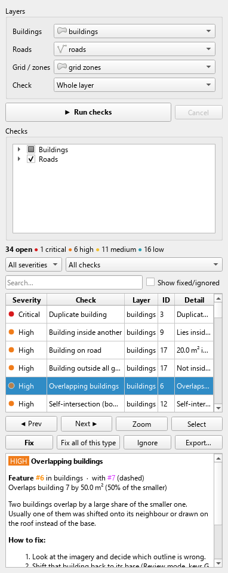
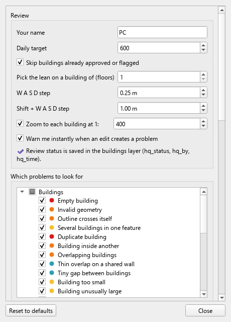

<p align="center">
  <picture>
    <source media="(prefers-color-scheme: dark)" srcset="assets/brand/logo-dark.svg">
    
  </picture>
</p>

<h1 align="center">Horus QC</h1>

<p align="center">
  <b>Simple building &amp; road quality control for grid-based digitising in QGIS</b><br>
  1 Check your grid · 2 Review every building with the keyboard
</p>

<p align="center">
  
  
  
  
</p>

---

Horus QC is made for teams that **review building footprints and roads against satellite imagery, one grid cell at a time**. The panel has two tabs, each with one big button:

- **1 Check** finds the problems in your grid and lists them by type. Click a problem to zoom to it and read what to do.
- **2 Review** walks you through every building in your grid. Press **1–9** to move a building from its roof to its base, then **E** to approve it.

It's the QGIS successor of [OVC (Overlap Violation Checker)](https://github.com/AmmarYasser455/ovc), rewritten in pure PyQGIS, so there's **nothing to `pip install`** and it works offline.

| 1 Check | 2 Review | ⚙ Settings |
|---|---|---|
|  |  |  |

## Install

**From QGIS (recommended):** go to **Plugins → Manage and Install Plugins… → All**, search for **Horus QC**, then **Install Plugin**. QGIS tells you when a new version is out (**Upgradable** tab).

> Brand-new plugins are reviewed by the QGIS plugin team before they appear in the list. Until then, use one of the options below.

**From this repository, with automatic updates:** go to **Plugins → Manage and Install Plugins… → Settings → Add…** and add:

```
https://raw.githubusercontent.com/AmmarYasser455/horus-qc/main/plugins.xml
```

**From ZIP:** download `horus_qc-x.y.z.zip` from the [latest release](https://github.com/AmmarYasser455/horus-qc/releases/latest), then go to **Plugins → Manage and Install Plugins… → Install from ZIP**.

Open the panel with the 👁 toolbar icon or **Ctrl+Alt+H**.

## How to use it

### 1 Check
1. Horus picks your **Buildings**, **Roads** and **Grid** layers by their names; change them if needed.
2. Select your grid cell on the map. **Area: Auto** checks your selected grid cells, or the map view if none are selected.
3. Press **▶ Check**.
4. Problems are grouped by type, most serious first. Click one, or use **Previous / Next**, to zoom to it:
   - the feature is outlined in orange;
   - the other feature involved is dashed purple;
   - the problem spot is yellow.

   The box below the list explains the problem and **what to do**.
5. Not a real problem? Press **Ignore**. It stays hidden on the next check too.

### 2 Review
1. Press **▶ Start review**. The first time, Horus asks whether to save who reviewed each building in the layer (fields `hq_status`, `hq_by`, `hq_time`).
2. Click the map once so it receives your keys.
3. Press **V**, click a roof corner, then the same corner at the base. Horus remembers this lean per floor for the grid.
4. For each building:

| Key | What it does |
|---|---|
| **1 – 9** | move the building to its base (number of floors) |
| **W A S D** | small move (with Shift: bigger move) |
| **E** | approve → next building |
| **F** | flag a problem → next building |
| **N / Q** | next / back |
| **Ctrl+Z** | undo |

The **Today** bar counts your work toward the daily target. **Export today's report** writes a CSV with a per-reviewer summary. While you edit, Horus warns you instantly if a building now overlaps a neighbour, sits on a road or crosses the grid edge.

### ⚙ Settings
Your name, the daily target, the W A S D step, zooming, instant warnings, which problems to look for, and every threshold. You only need it to tune Horus to your project.

## What it looks for (28 checks)

Everything is measured in **metres**, even when your data is in degrees (EPSG:4326).

| Buildings | Roads |
|---|---|
| Empty building · Invalid geometry · Outline crosses itself | Empty road · Invalid road line · Road crosses itself |
| Several buildings in one feature · Duplicate building | Several roads in one feature · Duplicate road |
| Building inside another · Overlapping buildings | Roads on top of each other |
| Thin overlap on a shared wall · Tiny gap between buildings | Road stops short of junction · Road runs past junction |
| Building too small · Building unusually large | Dead end (T-junctions count as connected) |
| Corners almost square · Spike in the outline | Road not connected to network |
| Building on road · Building very close to road (off by default) | Very short road piece |
| Building crosses grid edge · Building outside all grids | |

## Privacy

Horus QC makes **no network requests**. Everything runs locally on the layers in your project.

## Development

```bash
# Windows (QGIS installed)
"C:\Program Files\QGIS 4.2.3\bin\python-qgis.bat" tests\run_tests.py

# Linux / CI
QT_QPA_PLATFORM=offscreen python3 tests/run_tests.py

# Build the installable ZIP (+ refresh plugins.xml)
python scripts/build_zip.py
```

CI runs the tests on QGIS 3.40 and 3.44 (Qt5) and the latest QGIS (Qt6).

```
horus_qc/
  core/        pure-PyQGIS engine: checks, review state (no UI)
  ui/          panel, settings window, map markers, review map tool, instant checks
  plugin.py    toolbar / menu wiring
tests/         engine + headless UI tests
```

### Releasing a new version

```bash
python scripts/bump_version.py 1.2.0 "Added X; fixed Y"   # version, changelog, plugins.xml
git commit -am "Release 1.2.0" && git tag v1.2.0
git push && git push origin v1.2.0
```

The tag builds the ZIP, creates the GitHub release and, once the `QGIS_PLUGIN_TOKEN` secret is set, publishes to **plugins.qgis.org**. To get the token, sign in to [plugins.qgis.org](https://plugins.qgis.org) with GitHub, upload the first ZIP with **Upload a plugin**, generate a token on the plugin's page, then run `gh secret set QGIS_PLUGIN_TOKEN --repo AmmarYasser455/horus-qc`.

## Credits

Overlap and road logic from [OVC](https://github.com/AmmarYasser455/ovc) by Ammar Yasser. MIT licensed.
