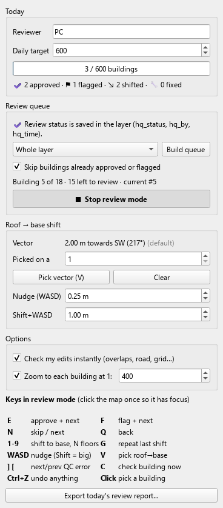

<p align="center">
  
</p>

<h1 align="center">Horus QC</h1>

<p align="center">
  <b>Building &amp; road quality control for grid-based digitising in QGIS</b><br>
  Classified overlaps · roof-to-base shifting · keyboard review queue · one-click fixes · instant checks
</p>

<p align="center">
  
  
  
  
</p>

---

Horus QC is built for teams that **review and correct building footprints and roads against satellite imagery, one grid cell at a time**. It checks the data like a topology checker. It also helps with the review itself: stepping through every building in your grid, shifting footprints from roof to base with one key, and catching a mistake the moment you make it.

It's the QGIS successor of [OVC (Overlap Violation Checker)](https://github.com/AmmarYasser455/ovc). The OVC overlap and road logic is rewritten in pure PyQGIS, so there's **nothing to `pip install`** and it works on offline machines.

| Check tab | Review tab |
|---|---|
|  |  |

## Install (2 minutes)

1. Download `horus_qc-x.y.z.zip` from the [latest release](https://github.com/AmmarYasser455/horus-qc/releases/latest).
2. In QGIS: **Plugins → Manage and Install Plugins… → Install from ZIP**, choose the file, then **Install Plugin**.
3. The 👁 Horus toolbar appears. Click the eye to open the panel (or press **Ctrl+Alt+H**).

**Team install with automatic updates:** in **Plugins → Manage and Install Plugins… → Settings → Add…**, add this repository URL:

```
https://raw.githubusercontent.com/AmmarYasser455/horus-qc/main/plugins.xml
```

Horus QC then appears in the plugin list like any other plugin, and QGIS offers each new version as an update.

## Daily workflow

1. **Check tab:** pick your *Buildings*, *Roads* and *Grid / zones* layers. Horus pre-selects layers whose names look like buildings, roads or grid. Set **Check** to *Selected grid cell(s)*, select your grid cells, then press **▶ Run checks**.
2. Work through the error list. Each row zooms to the problem and highlights:
   - the feature (orange),
   - the other feature involved (purple, dashed),
   - the exact problem area or point (yellow).
   The guidance panel explains the error and how to fix it. **Fix** applies the one-click fix; **Ignore** marks a false positive, and the project remembers it.
3. **Review tab:** press **Build queue**, then **▶ Start review mode**. Horus walks through every building in your grid in rows, like mowing a lawn, so the map barely moves between buildings:

| Key | Action | Key | Action |
|---|---|---|---|
| **E** | approve + next | **F** | flag + next |
| **N** | skip / next | **Q** | back |
| **1 – 9** | shift to base by *N* floors | **G** | repeat last shift |
| **W A S D** | nudge 0.25 m (Shift = 1 m) | **V** | pick roof → base vector |
| **] [** | next / previous QC error | **C** | check this building now |
| **Click** | pick a building | **Ctrl+Z** | undo anything |

4. **Roof → base shift:** off-nadir images make every building in a scene lean the same way, by an amount that grows with height. Press **V**, click a roof corner, then the same corner at the base. Horus stores that lean *per floor* and *per grid cell*. After that, **2** moves a two-floor building to its base, and **G** repeats the last shift. Select several buildings to shift them all at once.
5. Every approve and flag writes `hq_status`, `hq_by` and `hq_time` into the buildings layer (one click adds the fields). Your **daily target** bar fills up, and **Export today's review report** writes a CSV with a per-reviewer summary.
6. With **Check my edits instantly** on, Horus re-checks a building ~0.4 s after you move or draw it. A red flash and a message tell you if it now overlaps a neighbour, sits on a road or crosses the grid edge.

## The 28 checks

Horus measures everything in **metres**: it uses the local UTM zone when the data is in degrees, so thresholds mean the same on EPSG:4326 as on projected data.

**Buildings**

| Check | Severity | One-click fix |
|---|---|---|
| Empty building | critical | delete |
| Invalid geometry | high | repair (makeValid) |
| Self-intersection (bow-tie) | high | untangle: a 4-corner bow-tie becomes the rectangle you meant to draw |
| Multipart building | medium | split into separate buildings |
| Duplicate building (≥95% identical) | critical | delete the duplicate |
| Building inside another | high | delete the inner one |
| Overlapping buildings (≥15% of the smaller) | high | cut the overlap from this building |
| Shared-wall sliver (attached houses) | low | cut the sliver → clean shared wall |
| Hairline gap between buildings (≤0.5 m) | low | snap the wall onto the neighbour |
| Building too small / unusually large | medium | delete (too small) |
| Corners almost square (3–12° off) | low | square the corners (Orthogonalize) |
| Spike / sharp vertex | medium | remove spike vertices |
| Building on road (road ± buffer) | high | manual: shift the building or fix the road |
| Building very close to road (set-back, off by default) | low | manual |
| Building crosses grid edge | medium | manual (owner = grid holding its centre) |
| Building outside all grids | high | manual |

**Roads**

| Check | Severity | One-click fix |
|---|---|---|
| Empty road / invalid geometry | critical / high | delete / repair |
| Road crosses itself | medium | manual |
| Multipart road | medium | split |
| Duplicate road / roads overlapping | high / medium | delete duplicate / manual |
| Road stops short of junction (undershoot ≤3 m) | medium | snap the end onto the road and add a junction vertex |
| Road overshoots junction (tail ≤3 m) | low | trim the tail at the junction |
| Dead end (T-junctions count as connected; grid-edge ends skipped) | low | manual |
| Isolated road piece | medium | manual |
| Very short segment | low | delete |

Every threshold is editable on the **Settings** tab. Every fix is a single undoable edit (Ctrl+Z), and nothing is saved until you save your layer edits.

## How it compares with Topology Checker Pro

| | Topology Checker Pro | Horus QC |
|---|---|---|
| Units | layer units (degrees on EPSG:4326) | always metres / m² |
| Overlaps | every overlap > 0 is an error | classified: duplicate / inside / overlap / shared-wall sliver |
| Shared walls of attached houses | flood the list | low-severity sliver with one-click clean-up |
| Dangles | any loose end | undershoot (auto-snap), overshoot (auto-trim), dead end; T-junctions OK |
| Cross-layer checks | none (one layer at a time) | building on road, set-back, grid edge, outside grid |
| Shape checks | none | near-square corners, spikes, tiny / huge buildings |
| Auto-fix | makeValid, multipart | 16 fixes, all undoable |
| Large layers | runs on the UI thread | background task with progress and cancel |
| Review workflow | none | review queue, keys, daily target, status fields, report |
| Roof → base shift | none | per-grid lean vector, 1–9 floors, WASD nudge |
| Instant check after each edit | none | yes |
| Errors as a layer | rubber bands only | styled marker layer + GeoPackage / CSV export |
| False positives | re-appear every run | Ignore, remembered in the project |

## Privacy

Horus QC makes **no network requests**. All checks and fixes run locally on the layers in your project.

## Development

```bash
# Windows (QGIS installed)
"C:\Program Files\QGIS 4.2.3\bin\python-qgis.bat" tests\run_tests.py

# Linux / CI
QT_QPA_PLATFORM=offscreen python3 tests/run_tests.py

# Build the installable ZIP (+ refresh plugins.xml)
python scripts/build_zip.py
```

CI runs the test suite against QGIS 3.40 and 3.44 (Qt5) and the latest QGIS (Qt6). Pushing a tag `vX.Y.Z` builds the ZIP and attaches it to a GitHub release.

```
horus_qc/
  core/        pure-PyQGIS engine: checks, fixes, review state (no UI)
  ui/          dock, markers, review map tool, live checker
  plugin.py    toolbar / menu wiring
tests/         engine + headless UI tests
```

## Credits

Overlap and road QC logic from [OVC](https://github.com/AmmarYasser455/ovc) by Ammar Yasser. MIT licensed.
